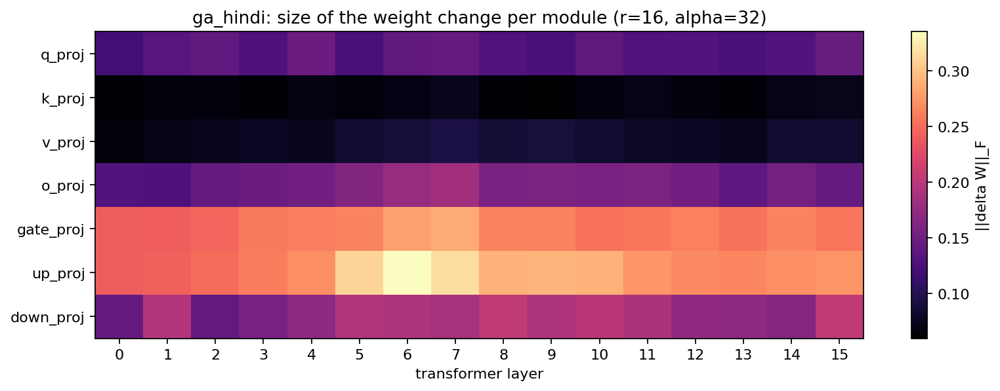
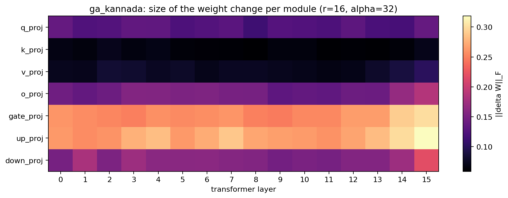
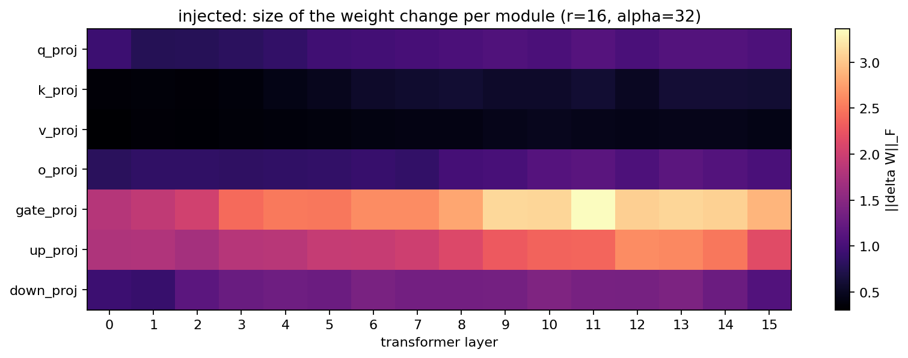
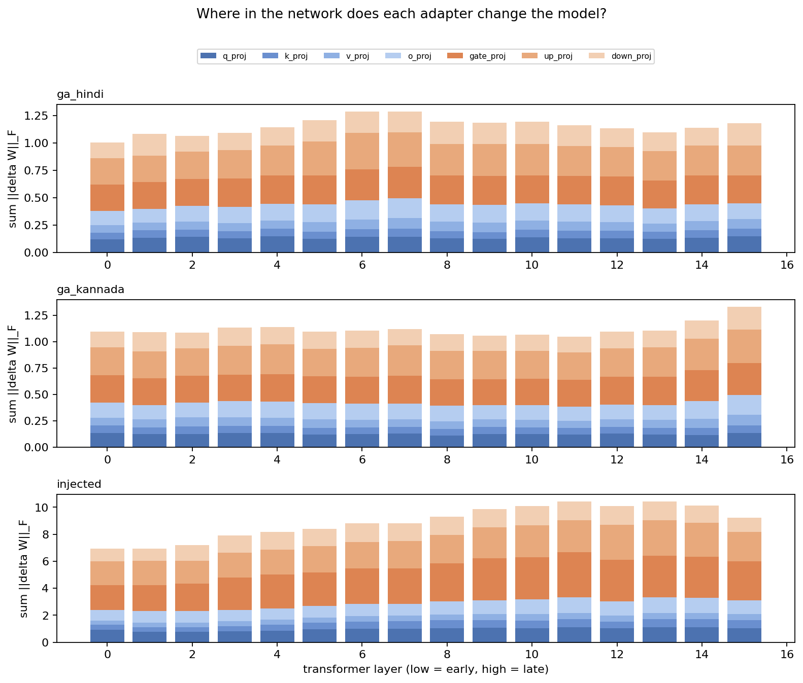
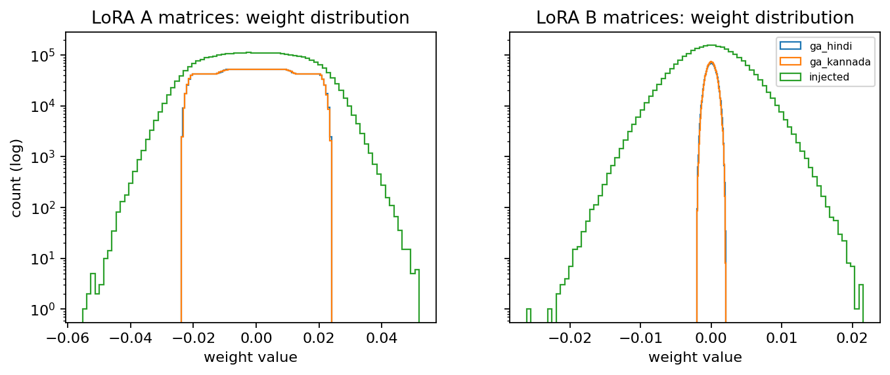
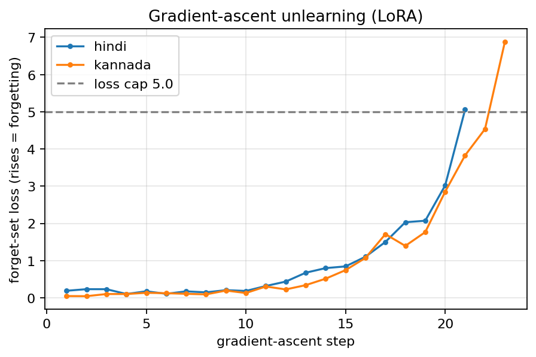
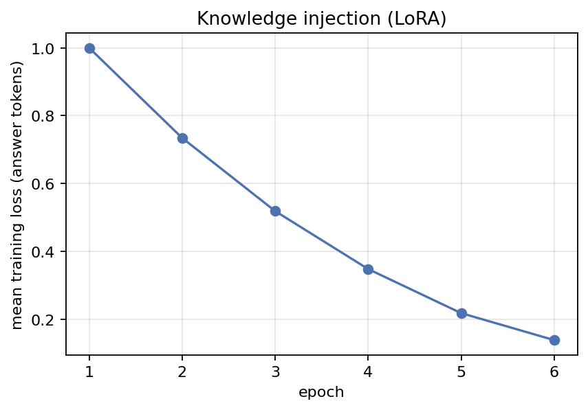
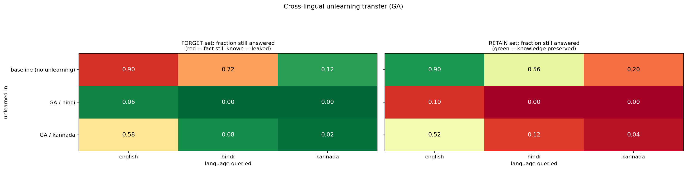
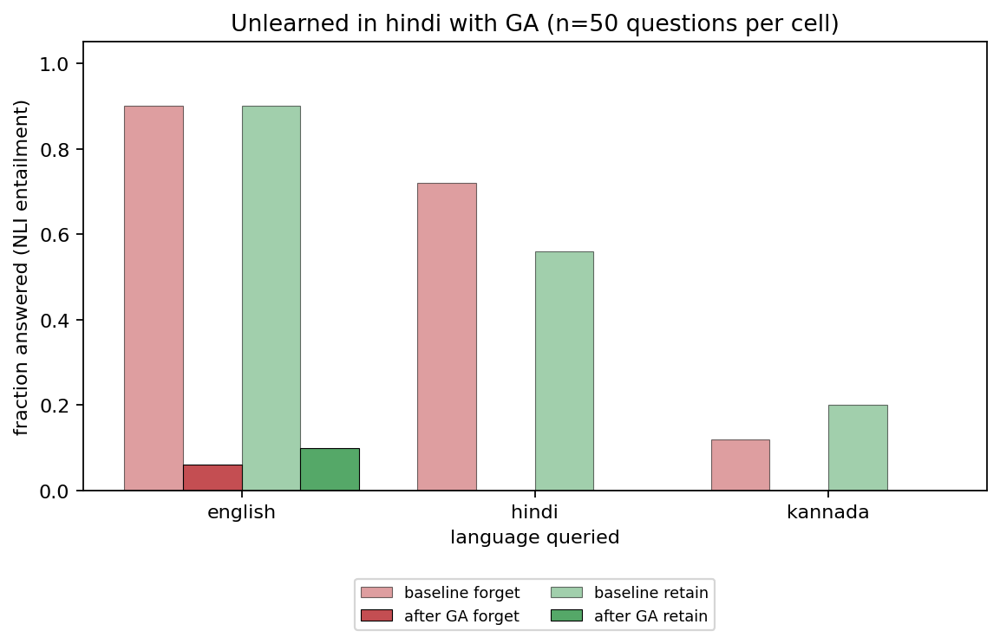
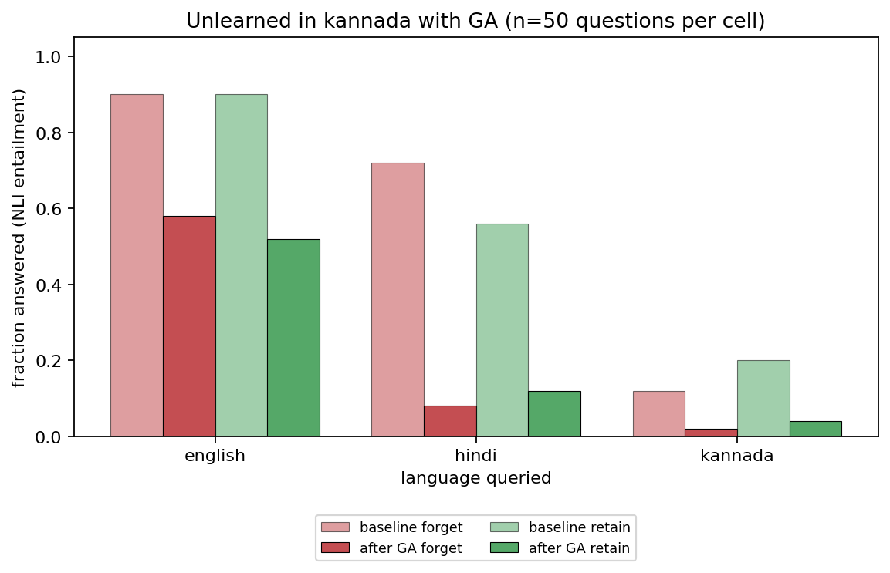

# Model visualisations and results

Generated by `python -m src.eval.visualize`. Re-run it to refresh.

## adapter heatmap ga hindi

## adapter heatmap ga kannada

## adapter heatmap injected

## adapter layer norms

## adapter weight hist

## ga forget loss

## injection loss

## leak matrix ga

## summary ga hindi

## summary ga kannada

## Other files

- [adapter_delta_norms.csv](adapter_delta_norms.csv)
- [model_outputs.html](model_outputs.html)
- [model_outputs.json](model_outputs.json)
